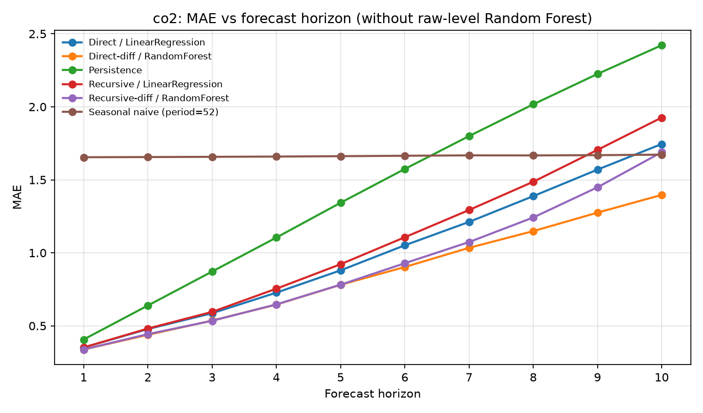
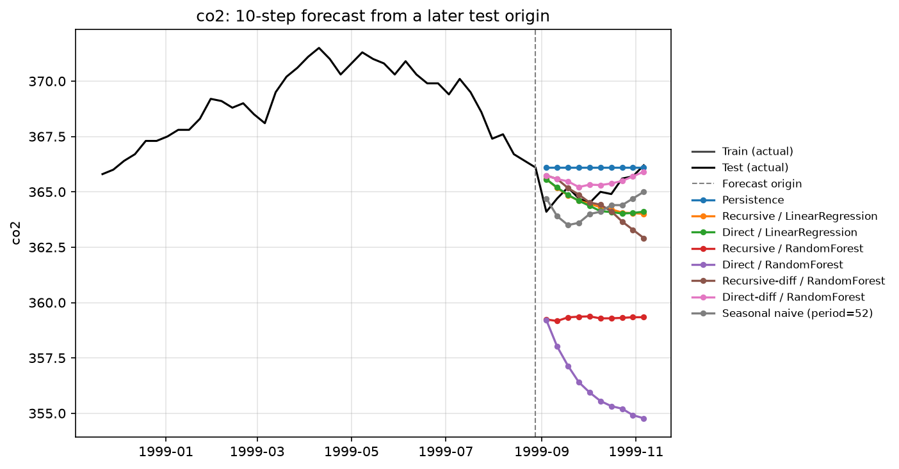
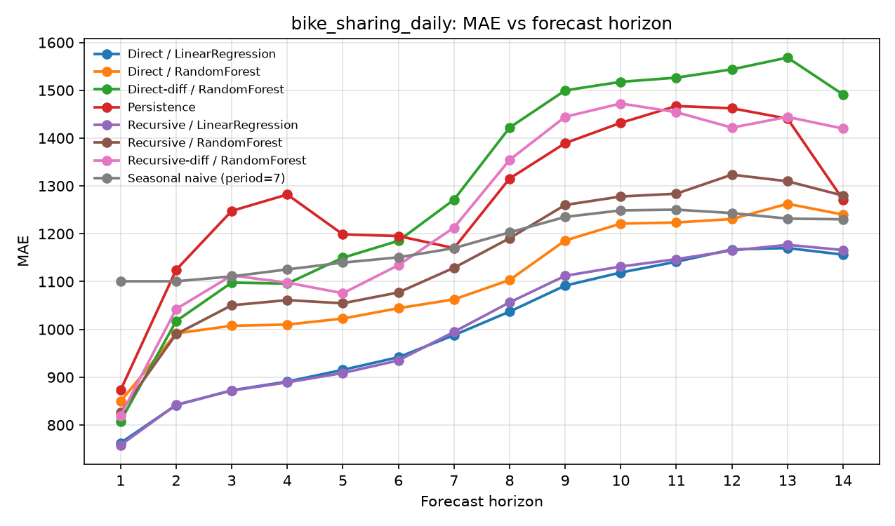

# Dự báo nhiều bước: đệ quy và trực tiếp

**Recursive vs direct multi-step forecasting**

## English summary

This project compares two standard ways of forecasting several steps ahead — a **recursive** strategy (one one-step model rolled forward) and a **direct** strategy (a separate model for each horizon) — using Linear Regression and Random Forest. The series are weekly Mauna Loa CO2 and daily bike-sharing rentals (the hourly UCI series, aggregated). Persistence and seasonal-naive forecasts are included as baselines.

On CO2, a Random Forest trained on raw levels **fails** (10-step MAE 9.67, R² −3.94): the test period continues the upward trend beyond any target the forest saw in training, and trees cannot extrapolate. Training the forest on first differences and integrating the predicted changes back onto the last observed level fixes that. The differenced direct forest then has the best 10-step MAE, **1.40**, ahead of direct Linear Regression at **1.75**. Direct models degrade more slowly than recursive ones as the horizon grows, as expected, because they do not feed their own errors back in.

The same differencing trick does **not** help on daily bike demand, which is seasonal rather than strongly trending. There, Linear Regression is best (1-step MAE 758 vs 873 for persistence).

This work is based on exercises from the Viet Nguyen AI ML course. The course helpers `create_ts_data` mutated the input DataFrame; windowing here always returns new arrays and leaves the series untouched.

## Bài toán

Cho một chuỗi thời gian đơn biến \(y_t\), hãy dự báo \(y_{t+1},\ldots,y_{t+H}\) từ một cửa sổ \(w\) giá trị vừa quan sát. Hai chiến lược được so sánh công bằng, cùng cửa sổ, cùng tập train/test chia theo thời gian:

- **Đệ quy (recursive):** huấn luyện một mô hình một bước. Khi dự báo $H$ bước, đầu ra được đưa trở lại cửa sổ, nên sai số có thể cộng dồn.
- **Trực tiếp (direct):** huấn luyện $H$ mô hình độc lập; mô hình $h$ học ánh xạ cửa sổ $\to y_{t+h}$. Không dùng dự báo của chính mình làm đầu vào.

## Dữ liệu

Cả hai file nằm trong `data/` và lấy từ bộ time-series của khóa học Viet Nguyen AI. Chi tiết trong [`data/README.md`](data/README.md).

| Chuỗi | Tần suất | Độ dài | Cửa sổ $w$ | Horizon $H$ | Train / test (80/20) |
|---|---|---:|---:|---:|---|
| CO2 (Mauna Loa) | tuần, 1958–2001 | 2,284 (nội suy tuyến tính 59 tuần thiếu) | 12 | 10 | 1,827 / 457 |
| Bike sharing | ngày (cộng `users` theo ngày từ chuỗi giờ) | 731 ngày, 2011–2012 | 14 | 14 | 584 / 147 |

Đánh giá walk-forward: với mỗi thời điểm gốc $t$ sao cho $t+1,\ldots,t+H$ nằm trong tập test, mô hình nhận cửa sổ thật kết thúc tại $t$ (có thể gồm vài điểm cuối tập train) rồi dự báo $H$ bước.

## Phương pháp

- Cửa sổ trượt được tạo bằng mảng mới, **không sửa** Series đầu vào (đây là lỗi của `create_ts_data` trong script gốc). Có bài kiểm tra trong `tests/test_windows.py`.
- Mô hình: `LinearRegression` và `RandomForestRegressor` (200 cây, `min_samples_leaf=2`).
- Baseline: persistence (lặp giá trị cuối) và seasonal naive (chu kỳ 52 tuần với CO2, 7 ngày với xe đạp).
- Mở rộng thêm: huấn luyện Random Forest trên **sai phân bậc một**, rồi cộng dồn thay đổi dự báo vào mức quan sát cuối — để kiểm tra giả thuyết cây không nội suy được xu hướng.
- Metric theo từng horizon: MAE, RMSE, R².

## Kết quả

Số liệu dưới đây lấy từ lần chạy thật, lưu tại `results/metrics.csv`.

### CO2 (đơn vị: ppm)

MAE tại một số horizon đại diện:

| Phương pháp | h=1 | h=5 | h=10 |
|---|---:|---:|---:|
| **Direct-diff / Random Forest** | **0.338** | **0.781** | **1.397** |
| Recursive-diff / Random Forest | 0.338 | 0.782 | 1.689 |
| Direct / Linear Regression | 0.352 | 0.880 | 1.745 |
| Recursive / Linear Regression | 0.352 | 0.922 | 1.926 |
| Persistence | 0.407 | 1.343 | 2.422 |
| Seasonal naive (chu kỳ 52) | 1.655 | 1.662 | 1.672 |
| Recursive / Random Forest (mức gốc) | 5.512 | 5.661 | 6.089 |
| Direct / Random Forest (mức gốc) | 5.532 | 8.330 | 9.673 |

R² tại h=10: Direct-diff RF **0.869**, Direct LR 0.810, Recursive LR 0.788, Direct RF trên mức gốc **−3.94**.





Quan sát:

- Linear Regression đã khá tốt vì chuỗi CO2 gần như là xu hướng tăng cộng mùa vụ tuần, dễ xấp xỉ tuyến tính trên cửa sổ 12 tuần. Chiến lược trực tiếp kém đi chậm hơn chiến lược đệ quy khi $h$ tăng (MAE h=10: 1.75 so với 1.93).
- Random Forest học trên **mức gốc** thất bại: tập test (1993–2001) tiếp tục đi lên trên mức cao nhất của tập train, trong khi cây không thể dự báo ngoài miền giá trị đã thấy. Đường dự báo từ một gốc năm 1999 nằm kẹt quanh 355–359 ppm, thấp hơn thực tế khoảng 365 ppm.
- Cùng mô hình đó, học trên sai phân rồi cộng dồn lại, trở thành phương pháp tốt nhất. Direct-diff RF thắng Direct LR ở mọi horizon đã đo. Recursive-diff RF gần bằng ở vài bước đầu, sau đó kém hơn vì sai số bị đưa trở lại cửa sổ — đúng với lý thuyết so sánh hai chiến lược.
- Seasonal naive gần như phẳng theo horizon (MAE ≈ 1.66) và bắt đầu hơn persistence từ khoảng h=7, nhưng vẫn kém các mô hình đã “sửa” xu hướng.

Biểu đồ đầy đủ, gồm cả hai đường RF mức gốc, nằm ở `results/co2_mae_vs_horizon.png`.

### Bike sharing (tổng lượt thuê mỗi ngày)

| Phương pháp | h=1 | h=7 | h=14 |
|---|---:|---:|---:|
| **Recursive / Linear Regression** | **758.0** | 994.9 | 1165.8 |
| **Direct / Linear Regression** | 762.5 | 987.9 | **1156.3** |
| Recursive / Random Forest | 826.4 | 1128.8 | 1279.7 |
| Direct / Random Forest | 849.2 | 1062.7 | 1240.0 |
| Recursive-diff / Random Forest | 819.4 | 1212.8 | 1419.9 |
| Direct-diff / Random Forest | 808.1 | 1271.3 | 1491.1 |
| Persistence | 872.7 | 1169.9 | 1271.1 |
| Seasonal naive (chu kỳ 7) | 1100.6 | 1169.9 | 1230.2 |



Ở đây Linear Regression là tốt nhất; đệ quy và trực tiếp gần như trùng nhau ở vài bước đầu, trực tiếp nhỉnh hơn một chút khi $h$ lớn. Sai phân **không giúp** Random Forest: chuỗi nhu cầu theo ngày có tính mùa và dao động quanh một mức, không phải xu hướng tăng dài hạn như CO2, nên học trên mức gốc phù hợp hơn. Đây là lý do nên thử cùng một ý tưởng trên hơn một chuỗi, chứ không kết luận từ mỗi CO2.

## Những gì khác với script gốc của khóa học

- Viết lại `create_ts_data` để không mutate DataFrame đầu vào; có test kiểm tra.
- So sánh đệ quy và trực tiếp trên cùng giao thức, báo cáo MAE / RMSE / R² **theo từng horizon**, không chỉ một horizon cố định.
- Thêm Random Forest (script gốc import nhưng không dùng), cộng baseline persistence và seasonal naive.
- Chạy thêm trên bike sharing (cộng theo ngày) chứ không chỉ CO2.
- Thí nghiệm follow-up: RF trên sai phân, sau khi quan sát RF mức gốc thất bại vì không nội suy được xu hướng.
- Repo có cấu trúc, biểu đồ và số liệu tái lập được.

## Cách chạy

```bash
python -m venv .venv
source .venv/bin/activate          # Windows: .venv\Scripts\activate
pip install -r requirements.txt
python tests/test_windows.py
python scripts/run_experiments.py
```

Kết quả được ghi vào `results/metrics.csv` và các file PNG cùng thư mục. Toàn bộ lần chạy trên máy này mất khoảng 10 phút, chủ yếu vì đánh giá walk-forward từng gốc với Random Forest.

## Nguồn

Dựa trên bài tập của khóa học machine learning của Viet Nguyen AI (các script `recursive_ts.py` và `direct_ts.py`). Dữ liệu xe đạp gốc là UCI Bike Sharing Dataset. Phần so sánh chiến lược, sửa lỗi, thí nghiệm sai phân và phân tích kết quả được làm thêm trên nền bài tập đó.
